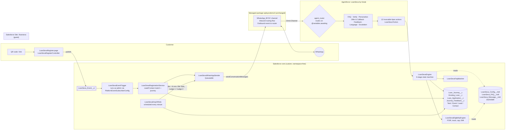

# LoanSeva by Kotak — WhatsApp Personal Loan Top-Up (PoC)

A customer-demo-ready WhatsApp banking journey for **Kotak Mahindra Bank**, built on Salesforce: an existing personal-loan customer goes from a QR code to a verified, personalised **PL Top-Up offer, reference number and RM callback** in one WhatsApp thread. A lightweight **PL LOS** runs behind it (application record, eligibility, offer, reference, RM Task + Event), and every drop-off becomes a warm lead with re-engagement nudges.

| | |
|---|---|
| Org alias | `kotak-demo` (API 65.0 source) |
| Registration page | `https://trailsignup-5e5549adddf5d7.my.salesforce-sites.com/loanseva` (QR: `?src=qr`, link: `?src=link`) — see SETUP_STEPS §2 |
| QR image | [`docs/LoanSeva_Registration_QR.png`](docs/LoanSeva_Registration_QR.png) / [`.svg`](docs/LoanSeva_Registration_QR.svg) |
| Agent | `LoanSeva by Kotak` — active Service Agent (`bots/`, `genAiPlannerBundles/`, `genAiPlugins/`, `genAiFunctions/`; generated by `scripts/gen_classic_agent.py`) |
| WhatsApp channel | `WhatsApp_BYOC` (from the installed *WhatsApp BYOC Demo (Meta)* package, `wpbyocdemo3`) |
| Demo OTP | `123456` (config: `LoanSeva_Config__mdt.Default.Demo_OTP__c`) |
| Manual steps | [`SETUP_STEPS.md`](SETUP_STEPS.md) |
| Acceptance | [`ACCEPTANCE_CHECKLIST.md`](ACCEPTANCE_CHECKLIST.md) |

## Architecture



**Design choice — deterministic engine, conversational agent.** All journey logic (state, validation, maths, copy in three languages) lives in `LoanSevaEngine`. Each Agentforce action is a thin wrapper that returns the customer-facing `message` plus an `awaiting` routing hint; the agent relays the message verbatim and uses `awaiting` to pick the next subagent. That keeps the CXO demo repeatable (same inputs → same outputs), keeps numbers out of the LLM, and makes the whole journey unit-testable without an agent.

**Journey stages** (`Loan_Journey__c.Stage__c`): Nudge → Start → Verify → Personalise → Offer → Callback → Feedback → Completed. Every answer is written the moment it is captured, together with `Fields_Completed__c`, `Drop_Point__c`, stage timestamps and language.

## Component list

### From the managed package — *WhatsApp BYOC Demo (Meta)* `wpbyocdemo3` 0.16.0.1 (reused, never modified)

| Component | Type | How LoanSeva uses it |
|---|---|---|
| `WhatsApp_BYOC` messaging channel + BYOC router integration | MessagingChannel / connected router | Carries every inbound and outbound WhatsApp message; our sender targets its end users |
| `wpbyocdemo3__WhatsApp_Send_Outbound_Event_to_Router_Prod` | Flow | Relays Salesforce outbound conversation messages (our nudges, agent replies) to Meta |
| `wpbyocdemo3__TEMPLATE_WhatsApp_Inbound_Routing` | Flow template | Starting point for the Omni-Channel flow that routes WhatsApp sessions to the LoanSeva agent (clone, SETUP_STEPS §4) |
| `wpbyocdemo3__TEMPLATE_WhatsApp_Grab_Session`, `…Route_to_Queue` | Flow templates | Human hand-off target for *Escalate to Human* |
| `wpbyocdemo3__SendEventService`, `WP_BYOC_Meta_Event__e`, `WhatsApp_BYOC_Setting__mdt`, `Debug_Log__c`, `prettyJsonFieldViewer` LWC | Apex / event / settings / logging | Package plumbing; `Debug_Log__c` is useful when a send doesn't arrive |

The package has no registration page, template sender or journey components, so those are custom.

### Custom (this repo, `force-app/main/default`)

| Area | Components |
|---|---|
| Data model | `Loan_Journey__c` (journey + drop-off intent), `Existing_Loan__c` (FSC not installed; masked number formula), `Loan_Application__c` (LOS record, reference number), `Journey_Feedback__c` |
| Configuration | `LoanSeva_Config__mdt.Default` (OTP, rates, FOIR, income buckets, tenures, fees, nudge timings, send mode, channel), `LoanSeva_FAQ__mdt` ×8 (grounded answers, EN/HI/MR), `LoanSeva_Message__mdt` ×44 (every customer-facing string, EN/HI/MR) |
| Engine | `LoanSevaEngine`, `LoanSevaEligibilityEngine`, `LoanSevaJourneyService`, `LoanSevaFaqMatcher`, `LoanSevaDateParser`, `LoanSevaI18n`, `LoanSevaConfig`, `LoanSevaException` |
| Agent actions | `LoanSevaStartAction`, `…FaqAction`, `…LanguageAction`, `…VerifyAction`, `…OtpAction`, `…ConfirmLoanAction`, `…PersonaliseAction`, `…OfferAction`, `…AcceptOfferAction`, `…CallbackAction`, `…FeedbackAction`, `…EscalateAction`, shared `LoanSevaActionResult` |
| Agent | `aiAuthoringBundles/LoanSeva_by_Kotak` (Agent Script; generated by `scripts/gen_agent.py`) with the router, 8 subagents and guardrails (masked account numbers only, never promises final approval, on-topic only, human hand-off on request or repeated confusion) |
| Registration (Stage 0) | `LoanSevaRegister.page` + `LoanSevaRegisterController`, `LoanSeva` Site, `LoanSevaLogo` static resource (**placeholder SVG — replace with the official Kotak asset**), `LoanSeva_Event__e` + `LoanSevaEventTrigger` + `LoanSevaEventTriggerConfig`, `LoanSevaRegistrationService` |
| Outbound WhatsApp | `LoanSevaWhatsAppSender` (Queueable; `sendConversationMessages` on the BYOC channel, or `LogOnly`), `LoanSeva_Text` conversation message definition |
| Drop-off | `LoanSevaDropOffJob` (self-rescheduling; drop → RM Task → nudge 1 → nudge 2) |
| Security | Permission sets `LoanSeva_Guest` (page + event publish only), `LoanSeva_Agent` (actions + objects for the agent user), `LoanSeva_Admin` |
| Tests | `LoanSevaEngineTest`, `LoanSevaActionsTest`, `LoanSevaUtilsTest`, `LoanSevaRegistrationTest`, `LoanSevaDropOffJobTest`, `LoanSevaWhatsAppSenderTest`, `LoanSevaTestData` — 42 tests, **96% coverage** across LoanSeva classes, every class ≥ 86% |
| Scripts | `scripts/apex/seed.apex` (3 demo customers — put real demo mobiles at the top), `post_deploy.apex`, `smoke.apex` (full journey in anonymous Apex), `create_agent_user.apex`, `scripts/deploy.sh`, generators `gen_actions.py`, `gen_agent.py`, `gen_permsets.py`, `content.py` |

### Demo customers (`seed.apex`)

| Customer | Loan (masked) | EMI | Track | Pre-approved | Demo story |
|---|---|---|---|---|---|
| Priya Sharma | XXXX XXXX 8901 | ₹11,800 | 12/12 ✅ | ₹5L | Happy path, best rate 10.99% |
| Rahul Deshmukh | XXXX XXXX 8902 | ₹8,600 | 11/12 | ₹3L | Good track: +1% and 80% cap |
| Ananya Iyer | XXXX XXXX 8903 | ₹21,500 | 12/12 ✅ | ₹10L | High-value; pick income "Below 50K" to show FOIR capping the offer |

All rates, fees and timelines are **illustrative demo placeholders** in `LoanSeva_Config__mdt` / `LoanSeva_FAQ__mdt`. Align them with Kotak's published terms before any external use.

## Deploy

```bash
sf project deploy start -d force-app -o kotak-demo --dry-run   # validate
scripts/deploy.sh force-app                                     # deploy (compact output)
sf apex run -f scripts/apex/post_deploy.apex -o kotak-demo      # perm sets + drop-off job
sf apex run -f scripts/apex/seed.apex -o kotak-demo             # demo customers (edit mobiles first)
sf apex run test -o kotak-demo -n LoanSevaEngineTest,LoanSevaActionsTest,LoanSevaUtilsTest,LoanSevaRegistrationTest,LoanSevaDropOffJobTest,LoanSevaWhatsAppSenderTest --code-coverage --wait 20
python3 scripts/runapex.py scripts/apex/smoke.apex               # end-to-end dry run, prints every reply
```

Then complete [`SETUP_STEPS.md`](SETUP_STEPS.md) (Omni routing, site access, live send mode).

## 2-minute live demo script

> Before you start: run `seed.apex` with the presenter's number as Priya, set `Send_Mode__c = ConversationMessage`, and open the phone mirror plus the Loan Journey list view (`Loan_Journey__c`, sorted by Last Activity) in a second tab.

| Time | Stage | Presenter does / says | Audience sees |
|---|---|---|---|
| 0:00 | **0 · Entry** | "A customer sees a Kotak poster or email." Scan the QR, enter Priya's mobile, tick consent, tap **Send me the details on WhatsApp**. | Kotak-red mobile form → "Check WhatsApp — LoanSeva is saying hello 👋" |
| 0:15 | **1 · Nudge** | Show the phone. | "Hi Priya, great news from Kotak! 🎉 … up to ₹5L … Reply *Continue Here!*" |
| 0:25 | **2 · Start / FAQ** | Reply `Continue Here!`, then type *"What's the interest rate?"* and *"How is this different from a new loan?"* | Grounded answers from the approved FAQ, each ending "Reply **Yes** to verify in 30 seconds" |
| 0:45 | **Language** | Type `HI`, then `EN` to switch back. | Same journey, now in हिंदी; nothing lost |
| 0:55 | **3 · Verify** | Reply `Yes` → `Priya Sharma, 98xxxxxxxx` → OTP `123456`. | Loan snapshot: XXXX XXXX 8901, outstanding, EMI ₹11,800, "12/12 EMIs on time ✅" → reply `1` to confirm |
| 1:10 | **4 · Personalise** | Tap through `1` Salaried → `Infosys` → `3` ₹1L–2L → `1` Home renovation → `4` ₹5L. | One question at a time, numbered quick replies |
| 1:25 | **5 · Offer** | Point out amount, 10.99%, 48-month EMI and the other tenures. Reply `2` → `36 months` to show it's editable, then `1` Accept → `2` callback slot. | Offer card, "preliminary offer, subject to final verification", reference **KMB-PLTU-YYMMDD-NNNN**, confirmed callback time |
| 1:40 | **RM view** | Switch to Salesforce: open the journey → Loan Application, the RM **Task** and **Event**. | "Priya — ₹5L top-up for home renovation, accepted offer, callback Thu 11:00" |
| 1:50 | **6 · Feedback** | Reply `5` → `1` → "Super quick!" | Warm sign-off with the reference number; `Journey_Feedback__c` stored |
| 1:55 | **Drop-off story** | "And if she had stopped at Stage 4?" Show a pre-staged dropped journey (or `smoke`/test data) with its RM Task and nudge 1/2 status. | Every drop-off becomes a warm lead: RM task after 2 min idle, nudges at 2 and 5 min (demo timings; 24 h / 72 h in production) |

**Fallbacks.** If WhatsApp delivery lags, run `python3 scripts/runapex.py scripts/apex/smoke.apex`. It drives the identical journey through the same engine and prints every reply. If the public site is unavailable, open `/apex/LoanSevaRegister` as an internal user (SETUP_STEPS §2).

## Data Cloud note

Data Cloud isn't used in this PoC. With it, `Loan_Journey__c` would be ingested via the CRM connector and mapped to the unified individual by mobile. `Drop_Point__c`, `Purpose__c`, `Desired_Amount__c` and `Offer_*` would become calculated insights (for example "top-up intent, last 7 days"). Those would feed a next-best-action segment for RM and marketing re-engagement instead of the fixed nudge timer.
